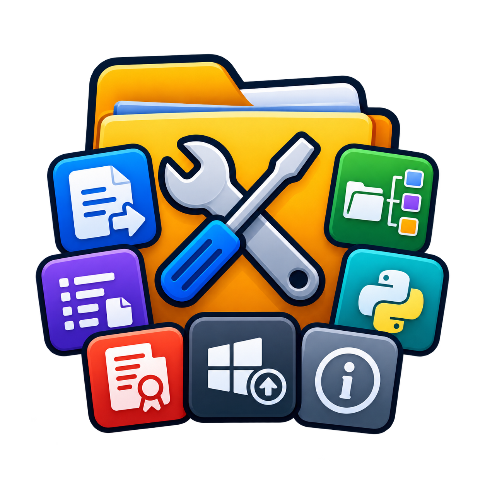

# Utilidades de archivos



App de escritorio para Windows (PyQt6) con utilidades para copiar, ordenar y documentar archivos y entornos de Python, más un actualizador de programas con winget que revisa cada instalador antes de ejecutarlo.

**Versión 1.2.0** · Creada por **DoMiNaTh0R** (Kevin González) · © 2026 · Licencia [GNU GPL v3](LICENSE)

Para instalarla o compilarla, mira **[INSTALL.md](INSTALL.md)**.

## Pestañas

| Pestaña | Qué hace |
|---|---|
| **Copiar** | Robocopy con carpetas y archivos a omitir, simulación y salida en vivo, con %, velocidad y tiempo restante. Elige los hilos según el disco (USB, HDD o SSD). Con `/MIR` o `/PURGE` te enseña antes qué se borraría del destino y pregunta. |
| **Organizar** | Cuenta los archivos de una carpeta por extensión y mueve o copia los que elijas a `<destino>\<extensión>\`, sin sobrescribir nada. |
| **Listar rutas** | Un `.txt` con las rutas de archivos y carpetas, con filtros por extensión y carpetas a ignorar. |
| **Info entorno** | Python y paquetes de un venv, un entorno de conda o el Python global, y su `requirements.txt` (en conda, también `environment.yml`). Lo de conda y el global se guarda en el Escritorio. |
| **Licencias** | `THIRD_PARTY_NOTICES.txt` con la licencia completa de cada paquete, con un JSON opcional para agregar componentes externos. |
| **Actualizaciones** | Actualiza tus programas con winget, uno por uno, con verificación y reporte (abajo). |
| **Acerca de** | Versión, licencia, dónde se guardan los datos y botones para abrirlos. |

Todo corre en segundo plano: la ventana no se congela. Tema claro y oscuro, y sesiones con nombre en Copiar, Listar rutas y Licencias.

## Actualizaciones con winget

**Antes de actualizar nada** comprueba que winget sea el original de Microsoft, que su origen sea el oficial y que la comprobación de SHA256 no esté desactivada. Si no, no actualiza.

**Cada paquete** se verifica antes de instalarlo:
- SHA256 y sitio de descarga del manifiesto, y el mismo SHA256 comparado con el que publica GitHub cuando el instalador viene de ahí.
- Firma digital opcional (con PowerShell), también la de los instaladores que vienen dentro de un `.zip` o `.nupkg` y la de los paquetes MSIX. Para autores que no firman (como 7-Zip) hay una lista de «sin firma, pero confío».
- Si el programa está abierto (te dice quién lo usa), si Windows Installer está ocupado (espera y reintenta) y si winget lo desinstalaría antes de instalar la versión nueva (pregunta antes).

**Durante la actualización** muestra el % real de cada descarga y en qué fase va. Al terminar vuelve a buscar y abre un reporte con la versión antes y después de cada programa, el motivo de cada fallo y un botón para reintentar.

**Revisión manual:** lo de la Microsoft Store, de orígenes de terceros y las distribuciones de conda (Miniforge, Miniconda, Anaconda) nunca se actualizan en lote. Conda se actualiza con `conda update -n base --all`.

También avisa si un antivirus inspecciona tus conexiones HTTPS (rompe la Microsoft Store en winget), indica si la app corre como administrador y puede reabrirla así sin perder lo que tenías marcado. Clic derecho en un paquete: copiar su enlace de descarga, el comando o el Id, o ignorarlo.

## Datos de la app

La configuración, las sesiones, los registros, los reportes y `fallo_grave.log` se guardan en `%LOCALAPPDATA%\DEUS MACHINA\UtilidadesArchivos`, igual con el `.exe` que con el código fuente. Desinstalar la app no borra esa carpeta.

## JSON extra de Licencias

Opcional (pestaña Licencias → *Mostrar opciones avanzadas*). Las rutas de `archivo` son relativas a la carpeta del JSON.

```json
{
  "encabezado": "Texto propio que va debajo del título.",
  "componentes": [
    { "nombre": "FFmpeg", "version": "7.0", "tipo": "GNU GPL v3",
      "url": "https://ffmpeg.org", "nota": "Proceso externo.", "archivo": "tools/ffmpeg/LICENSE" }
  ],
  "faltantes": { "paquete-sin-licencia": { "tipo": "MIT", "texto": "…" } }
}
```

## Licencia

Copyright © 2026 Kevin González (DoMiNaTh0R). Software libre bajo la **GNU GPL v3** o (a tu elección) cualquier versión posterior, sin ninguna garantía. Texto completo en [LICENSE](LICENSE).

**Excepción:** el logo y el avatar (`recursos\logo_app.png`, `app.ico` y `avatar_DoMiN.jpg`) **no están bajo la GPL**. Solo se pueden redistribuir sin modificar como parte de copias de este programa; si publicas una versión modificada, cámbialos por los tuyos. Detalles en [LICENCIA_LOGO_Y_AVATAR.txt](recursos/LICENCIA_LOGO_Y_AVATAR.txt).

Usa [PyQt6](https://www.riverbankcomputing.com/software/pyqt/) (GPL v3) y [Qt](https://www.qt.io/) (LGPL v3). Robocopy, PowerShell y winget son programas de Windows que la app solo ejecuta.
